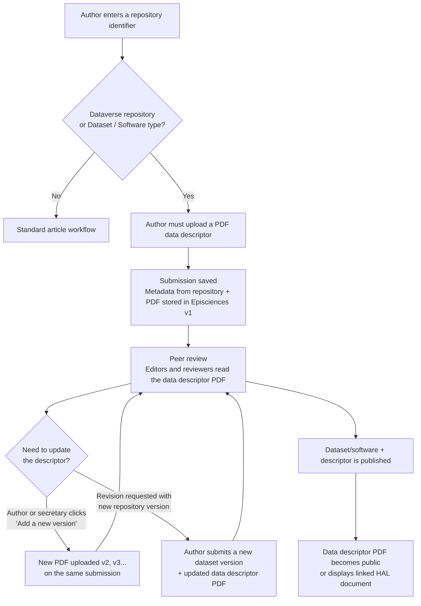

  Rights:
  <ul class="roles-list" role="list">
    <li>Administrator</li>
    <li>Editor in chief</li>
    <li>Editorial secretary</li>
    <li>Author</li>
  </ul>

When an author submits a **dataset** (or **software**), the editorial workflow in Episciences works differently from a standard article submission. The dataset itself stays on its source repository (e.g., Dataverse, Zenodo), while the **data descriptor** - the document that describes the dataset and is evaluated during peer review - is uploaded as a **PDF file directly into Episciences**.

:::note
This page is about submitting a dataset or software **as the submission itself**. To attach a dataset or software to an article, see [Linking publications/data/software](/en/software/).
:::

## What changes compared to a standard article?

| Step                      | Standard article                                                      | Dataset with data descriptor                                                                           |
| ------------------------- | --------------------------------------------------------------------- | ------------------------------------------------------------------------------------------------------ |
| **What is evaluated**     | The manuscript hosted on the repository (or a temporary file)         | The **data descriptor PDF** uploaded in Episciences                                                    |
| **At submission**         | Only the repository identifier is required                            | Selecting a dataset automatically requires uploading a **PDF data descriptor**                         |
| **Updating the text**     | Requires a revision request and a temporary or new repository version | The author or editorial secretary can **upload a new descriptor PDF directly on the same submission**  |
| **Master file selection** | Available when a repository record contains multiple files            | Not applicable (the uploaded descriptor PDF is always the evaluated document)                          |
| **After publication**     | Links to the repository file / record                                 | The descriptor PDF is **publicly displayed** (or switches to a linked HAL record if one is associated) |

## Workflow diagram

## Step-by-step overview

### 1. Submission

- When the author enters an identifier from a **Dataverse** repository, or a record whose type is **Dataset** (or **Software**), the submission form automatically displays a required **Data descriptor** (or **Software descriptor**) upload field.
- Only **PDF** files are accepted.
- The dataset metadata (title, authors, abstract, repository link, etc.) is imported from the repository as usual, while the uploaded PDF is stored in Episciences as the document to review.

### 2. Peer review and access rights

- **Reviewers**, **editorial staff** (without a conflict of interest), the **author**, and **co-authors** can view the **Data descriptor** panel on the paper page, which includes an embedded PDF viewer showing the **latest version** of the descriptor.
- **Version list visibility**: only the **author (owner)**, **editor in chief**, **editorial secretary**, and **administrator** see the full list of descriptor versions; all other users (such as reviewers or regular editors) only see the embedded viewer.
- Before publication, the descriptor PDF is **not** public.

### 3. Updating the data descriptor

There are two ways a data descriptor can be updated during the editorial process:

1. **Uploading a new descriptor version on the same submission**
   - As long as the submission is still in an editable status (i.e., not published, refused, obsolete, deleted, or abandoned), the roles with version-list access above see an **"Add a new version"** button in the Data descriptor panel.
   - Uploading a new PDF adds a new version (`v2`, `v3`, …) to the same submission without creating a new paper version or changing its identifier.
   - Previous versions remain listed with their submission dates; when multiple versions exist, the most recent one is tagged **"latest version"** and is automatically shown in the embedded viewer.
   - Identical files (already uploaded for this submission) are automatically rejected to avoid duplicates.

2. **Submitting a full new version of the dataset**
   - If you request a revision and the author submits a **new version** of the dataset from the repository, the new-version form also allows them to upload an updated data descriptor PDF.

### 4. Publication

- Once the submission is **published**, the data descriptor becomes **publicly visible** on the paper's public page.
- If a **HAL** record is linked to the submission as the published data descriptor, the public page displays that HAL document; otherwise, it continues to display the latest uploaded PDF.
