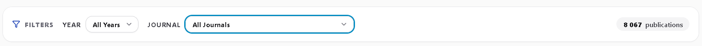
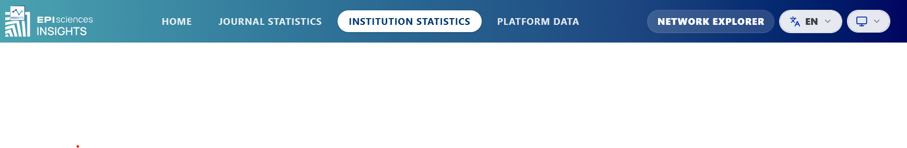

    Access:
    <ul class="roles-list" role="list">
      <li>Public – no login required</li>
    </ul>

## About this website 

Episciences Insights is a public dashboard of metrics related to diamond open-access publications hosted by the Episciences platform. The data comes exclusively from open infrastructures (Episciences, OpenAlex, OpenAIRE Graph, ROR, zbMATH Open, and Episciences user journals) and is updated monthly. In accordance with the DORA and CoARA principles, no proprietary metrics such as the impact factor are displayed.
The website is available in three languages (English, French, Spanish).

***

## Browse and apply filters

### Website Navigation

The top section of the Dashboard is a menu that provides access to several pages: a Journals page, an Institutions page, and a Platform page. \
These pages are supplemented by a Network Explorer.

### Change Language and Theme

The language selector in the header lets you switch between English, French, and Spanish at any time. The theme selector lets you choose between light mode, dark mode, or your device's system theme. These settings apply to all pages on the site.

### Filter toolbar

All dashboard pages, except for the home page and the methodology page, display a global filter bar at the top of the page. This bar includes:

* **Year Filter**: a drop-down list that allows you to limit the indicators to a specific publication year, or to select “All Years” for the entire period;
* **Journal Filter**: a drop-down list of hosted journals, displayed on the journals page and in the network explorer;
* **Institution Filter**: a selector with a search field, displayed on the institutions page;
* **Reset Button**: a reset button, visible whenever a filter is active, that allows you to return to the entire corpus with a single click;
* **Publication Counter**: a real-time display of the number of publications matching the active filters.

### Combining Filters

Filters are applied cumulatively: for example, selecting a specific year and a particular journal recalculates all the charts on the page for that specific range. The number of publications affected is continuously updated to the right of the filter bar, allowing you to immediately see the effect of each filter.
To return to the full view, click the “Reset” button.

***

## Search for journals and organizations

### Search for a journal (Journal Statistics page)

The “Journal Statistics” page is designed for journal editorial boards. To search for a specific journal:

1. Open the journals page from the home page or from the navigation menu that remains displayed at the top of each page;
2. Use the journal selector in the filter bar to select the relevant journal from the drop-down list, which is organized alphabetically;
3. All metrics on the page are then recalculated for that specific journal.\

Note: You cannot select multiple journals at the same time. \
To return to the list of all journals, select the “All Journals” option at the top of the list, or click the Reset button.

Note 2: If you select a journal and switch to the “Statistics by Institution” tab without resetting, the statistics that appear will apply only to that journal.

The metrics provided for a journal include, among others:

* readership: usage trends (downloads and page views), trends over time, and geographic distribution of readers;
* authorship: geographic distribution of authors and preprint repository footprint;
* publication topics;
* funding sources for published works.

### Search for an organization (Statistics by Institution section)

The “Institution statistics” page allows you to measure an institution’s presence in Episciences publications. To search for an organization:

1. Open the page dedicated to institutions from the home page or from the navigation menu that remains displayed at the top of the pages;
2. Click the “Institution” dropdown in the filter bar;
3. Enter the name of the organization (e.g., CNRS, Inria, Oxford) or a country in the search field that appears. The list is filtered as you type. The search for an organization’s name is based on the name recorded in the ROR. Acronyms are not always supported (e.g., Inria can only be found by using “Institut national de recherche en sciences et technologies du numérique”).
4. Select the desired organization. Each entry lists its country, its ROR identifier (if applicable), as well as the number of unique publications and the number of author affiliations associated with it;
5. If the list is long, a button allows you to display the next results in batches of 100.

Note: You cannot select multiple organizations at the same time.
To return to the list of all institutions, select the “All Institutions” option at the top of the list or click the Reset button.

Note 2: If you have selected a journal in the “Journal Statistics” tab without resetting, and then switch to the “Statistics by Institution” tab, the institutional statistics displayed will pertain only to that journal.

Once the organization is selected, the page displays its output on Episciences, its co-authorship networks, the journals hosting its articles, the associated topics, and the funding agencies.

***

## Explore the data

### Types of Visualizations

Depending on the page, the metrics are presented as various types of charts and maps: bar charts, line charts, area charts, treemaps, world choropleth maps, Sankey diagrams, force-directed networks, co-occurrence matrices, and radar charts. On the Network Exploration page, each chart can be opened in full-screen mode for detailed exploration.

### Exporting Data and Charts

Each visualization has an export menu that allows you to download

* an image of the chart in PNG format or in SVG vector format;
* certain data can be exported in CSV or JSON format.

The platform's consolidated datasets (publications and funders) can also be downloaded from the methodology page.

### View the Methodology

The “Methodology” page (link available at the bottom of the page) details the context, data sources, methods used to calculate the indicators (including the SDG Impact Score and the co-financing network), known limitations, and how the results can be replicated. It is recommended that you review this page before interpreting the indicators - for example, to understand that usage metrics are not directly comparable across different journals.

### Network Explorer

The visualizations provided in the Journals, Institutions, and Platforms tabs are supplemented by a Network Explorer that allows you to examine the networks represented in the publications: international collaborations, thematic combinations, and funding sources.
The link to the Network Explorer is located in the navigation menu, which remains displayed at the top of each page.

This data can be filtered by year and by journal (filters can be applied simultaneously).
