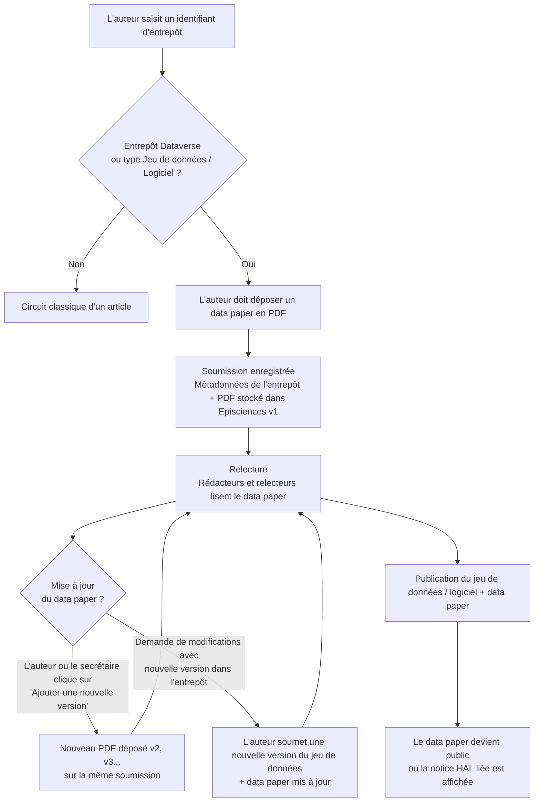

  Rôles :
  <ul class="roles-list" role="list">
    <li>administrateur</li>
    <li>rédacteur en chef</li>
    <li>secrétaire de rédaction</li>
    <li>auteur</li>
  </ul>

Lorsqu’un auteur soumet un **jeu de données** (ou un **logiciel**), le circuit éditorial d’Episciences diffère de celui d’un article classique. Le jeu de données reste dans son entrepôt d’origine (par exemple Dataverse, Zenodo), tandis que le **data paper** (descripteur de données) - le document qui décrit le jeu de données et qui est évalué lors de la relecture - est déposé sous forme de **fichier PDF directement dans Episciences**.

:::note
Cette page concerne la soumission d’un jeu de données ou d’un logiciel **en tant que soumission à part entière**. Pour lier un jeu de données ou un logiciel à un article, consulter la page [Lier publications / données / logiciels](/fr/software/).
:::

## Qu’est-ce qui change par rapport à un article classique ?

| Étape                          | Article classique                                                                                       | Jeu de données avec data paper                                                                            |
| ------------------------------ | ------------------------------------------------------------------------------------------------------- | --------------------------------------------------------------------------------------------------------- |
| **Ce qui est évalué**          | Le manuscrit hébergé dans l’archive ouverte (ou un fichier temporaire)                                  | Le **PDF du data paper** déposé dans Episciences                                                          |
| **Lors de la soumission**      | Seul l’identifiant dans l’archive est demandé                                                           | La sélection d’un jeu de données impose le dépôt d’un **data paper au format PDF**                        |
| **Mise à jour du texte**       | Nécessite une demande de modifications et une version temporaire ou une nouvelle version dans l’archive | L’auteur ou le secrétaire de rédaction peut **déposer un nouveau PDF directement sur la même soumission** |
| **Choix du fichier principal** | Possible lorsque la notice de l’archive contient plusieurs fichiers                                     | Sans objet (le PDF déposé est toujours le document évalué)                                                |
| **Après publication**          | Lien vers le fichier ou la notice de l’archive                                                          | Le PDF du data paper est **affiché publiquement** (ou remplacé par une notice HAL liée, le cas échéant)   |

## Schéma du circuit

## Étapes détaillées

### 1. Soumission

- Lorsque l’auteur saisit un identifiant provenant d’un entrepôt **Dataverse**, ou d’une notice dont le type est **Jeu de données** (ou **Logiciel**), le formulaire de soumission affiche automatiquement un champ obligatoire de dépôt du **data paper** (ou du **descripteur de logiciel**).
- Seuls les fichiers **PDF** sont acceptés.
- Les métadonnées du jeu de données (titre, auteurs, résumé, lien vers l’entrepôt, etc.) sont importées depuis l’entrepôt comme d’habitude, tandis que le PDF déposé est stocké dans Episciences comme document à évaluer.

### 2. Relecture et droits d’accès

- Les **relecteurs**, l’**équipe éditoriale** (sans conflit d’intérêts), l’**auteur** et les **co-auteurs** peuvent consulter le panneau **Data paper** de la page de l’article, qui comporte une visionneuse PDF intégrée affichant la **dernière version** du document.
- **Liste des versions** : seuls l’**auteur (propriétaire de la soumission)**, le **rédacteur en chef**, le **secrétaire de rédaction** et l’**administrateur** voient la liste complète des versions ; les autres utilisateurs (relecteurs, rédacteurs, etc.) ne voient que la visionneuse intégrée.
- Avant publication, le PDF du data paper n’est **pas** public.

### 3. Mettre à jour le data paper

Le data paper peut être mis à jour de deux manières au cours du processus éditorial :

1. **Déposer une nouvelle version du data paper sur la même soumission**
   - Tant que la soumission se trouve dans un statut modifiable (c’est-à-dire ni publiée, ni refusée, ni obsolète, ni supprimée, ni abandonnée), les rôles ayant accès à la liste des versions voient un bouton **« Ajouter une nouvelle version »** dans le panneau Data paper.
   - Le dépôt d’un nouveau PDF ajoute une nouvelle version (`v2`, `v3`, …) à la même soumission, sans créer de nouvelle version de l’article ni modifier son identifiant.
   - Les versions précédentes restent listées avec leur date de dépôt ; lorsqu’il existe plusieurs versions, la plus récente est marquée **« dernière version »** et s’affiche automatiquement dans la visionneuse.
   - Les fichiers identiques (déjà déposés pour cette soumission) sont automatiquement refusés afin d’éviter les doublons.

2. **Soumettre une nouvelle version complète du jeu de données**
   - Si une demande de modifications est envoyée et que l’auteur soumet une **nouvelle version** du jeu de données depuis l’entrepôt, le formulaire de nouvelle version permet également de déposer un data paper mis à jour.

### 4. Publication

- Une fois la soumission **publiée**, le data paper devient **visible publiquement** sur la page publique de l’article.
- Si une notice **HAL** est liée à la soumission en tant que data paper publié, la page publique affiche ce document HAL ; sinon, elle continue d’afficher le dernier PDF déposé.
