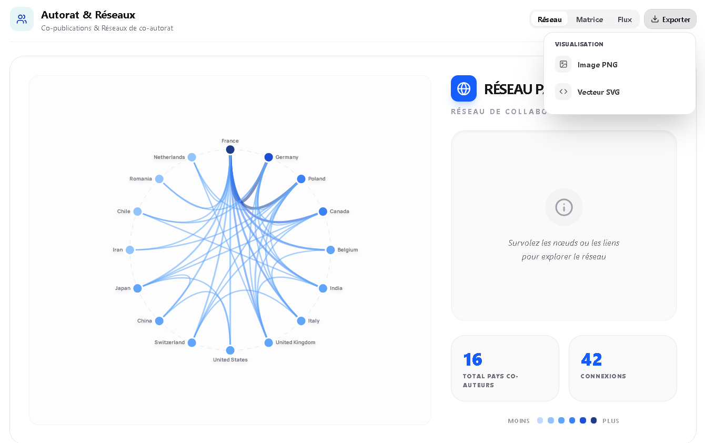
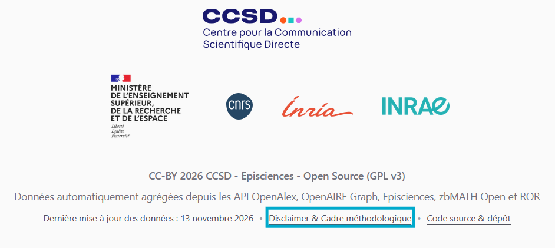

    Accès :
    <ul class="roles-list" role="list">
      <li>Public – sans connexion</li>
    </ul>

## À propos du site

Episciences Insights est un tableau de bord public d'indicateurs portant sur les publications en libre accès diamant hébergées par la plateforme Episciences. Les données proviennent exclusivement d'infrastructures ouvertes (Episciences, OpenAlex, OpenAIRE Graph, ROR, zbMATH Open, journaux d'usage Episciences) et sont mises à jour mensuellement. Conformément aux principes de DORA et de CoARA, aucun indicateur propriétaire tel que le facteur d'impact n'est affiché.
Le site est disponible en trois langues (anglais, français, espagnol).

***

## Naviguer et appliquer des filtres

### Navigation générale

La partie supérieure du Dashboard est un menu  qui donne accès à des pages : une page Revues, une page Institutions et une page Plateforme. \
Ces pages sont complétées par un Explorateur de réseau. 

### Changer de langue et de thème

Le sélecteur de langue situé dans l'en-tête permet de basculer à tout moment entre l'anglais, le français et l'espagnol. Le sélecteur de thème permet de choisir le thème clair, le thème sombre ou le thème système de votre appareil. Ces réglages s'appliquent à l'ensemble des pages du site.

### La barre de filtres globale

Toutes les pages du tableau de bord, à l'exception de la page d'accueil et de la page de méthodologie, affichent une barre de filtres globale en haut de page. Cette barre comporte :

* **Filtre Année** : liste déroulante permettant de restreindre les indicateurs à une année de publication donnée, ou de conserver « Toutes les années » pour l'ensemble de la période ;
* **Filtre Revue** : liste déroulante des revues hébergées, affichée sur la page des revues et sur l'explorateur de réseau 
* **Filtre Institution** : sélecteur avec champ de recherche, affiché sur la page des institutions ;
* **Bouton Réinitialisation** : bouton de réinitialisation, visible dès qu'un filtre est actif, permettant de revenir d'un clic à l'ensemble du corpus ;
* **Compteur de publications** : affichage en temps réel du nombre de publications correspondant aux filtres actifs. 

### Combiner les filtres

Les filtres se combinent de manière cumulative : par exemple, sélectionner une année précise et une revue particulière recalcule l'ensemble des graphiques de la page pour ce seul périmètre. Le nombre de publications concernées est mis à jour en permanence à droite de la barre de filtres, ce qui permet de contrôler immédiatement l'effet de chaque filtre.
Pour revenir à la vue complète, cliquez sur le bouton « Réinitialiser».

***

## Rechercher des revues et des organisations

### Rechercher une revue (page Statistiques à l'usage des revues)

L'espace « Statistiques à l'usage des revues » est conçu pour les comités de revues. Pour cibler une revue particulière :

1. Ouvrez la page dédiée aux revues depuis la page d'accueil ou dans le menu de navigation qui reste affiché en haut des pages  ;

2. Utilisez le sélecteur de revue situé dans la barre de filtres pour choisir la revue concernée, dans la liste déroulante organisée par ordre alphabétique ;
3. Tous les indicateurs de la page sont alors recalculés pour cette seule revue.

NB : Il n'est pas possible de sélectionner plusieurs revues en même temps. \
Pour revenir à l'ensemble des revues, sélectionnez l'option « Toutes les revues » en tête de liste, ou cliquer sur le bouton Réinitialiser.

NB2 : si vous sélectionnez une revue, et passez à l'onglet "Statistiques par institution" sans réinitialiser, les statistiques qui apparaîtront concerneront uniquement la revue. 

Les indicateurs proposés pour une revue comprennent notamment :

* le lectorat : dynamique d'usage (téléchargements et consultations de pages), évolution dans le temps et répartition géographique des lecteurs ;
* l'autorat : répartition géographique des auteurs et empreinte des dépôts de préprints ;
* les thématiques de publication ;
* les financeurs des travaux publiés.

### Rechercher une organisation (espace Statistiques par institutions)

L'espace « Statistiques à l'usage des institutions » permet de mesurer la présence d'un établissement dans les publications Episciences. Pour rechercher une organisation :

1. Ouvrez la page dédiée aux institutions depuis la page d'accueil ou dans le menu de navigation qui reste affiché en haut des pages ;

2. Cliquez sur le sélecteur « Institution » dans la barre de filtres ;
3. Saisissez le nom de l'organisation (par exemple CNRS, Inria, Oxford) ou un pays dans le champ de recherche qui s'affiche. La liste se filtre au fur et à mesure de la saisie. La recherche du nom d'une organisation se fait par le nom enregistré dans le ROR. Les acronymes ne sont pas toujours supportés (ex: Inria n'est trouvable qu'en utilisant "Institut national de recherche en sciences et technologies du numérique"). 
4. Sélectionnez l'organisation souhaitée. Chaque entrée indique son pays, son identifiant ROR le cas échéant, ainsi que le nombre de publications uniques et le nombre d'affiliations d'auteurs associés ;
5. Si la liste est longue, un bouton permet d'afficher les résultats suivants par lots de 100.

NB : Il n'est pas possible de sélectionner plusieurs organisations en même temps. 
Pour revenir à l'ensemble des institutions, sélectionnez l'option « Toutes les institutions » en tête de liste ou cliquer sur le bouton Réinitialiser.

NB2 : si vous avez sélectionné une revue dans l'onglet "Statistiques des revues" sans réinitialiser, et passez à l'onglet "Statistiques par institution", les statistiques d'institutions qui s'afficheront ne concerneront que la revue. 

Une fois l'organisation sélectionnée, la page présente sa production sur Episciences, ses réseaux de co-autorat, les revues hébergeant ses articles, les thématiques et les financeurs associés.

***

## Explorer les données

### Les types de visualisations

Selon les pages, les indicateurs sont présentés sous forme de graphiques et cartes de différents types: en barres, courbes et aires, treemaps, carte choroplèthe du monde, diagrammes de Sankey, réseaux dirigés par force, matrices de co-occurrence et radar. Dans la page Exploration réseau, chaque graphique peut être ouvert en plein écran pour une exploration détaillée.

### Exporter les données et les graphiques

Chaque visualisation dispose d'un menu d'export permettant de télécharger

* l'image du graphique au format PNG  ou au format vectoriel SVG ;
* certaines données peuvent être exportées au format CSV ou au format JSON.

Les jeux de données consolidés de la plateforme (publications et financeurs) sont également téléchargeables depuis la page de méthodologie.

### Consulter la méthodologie

La page « Methodologie » (lien disponible en pied de page) détaille le contexte, les sources de données, les méthodes de calcul des indicateurs (notamment le score d'impact ODD et le réseau de cofinancement), les limites connues et les modalités de reproductibilité. Il est recommandé de la consulter avant d'interpréter les indicateurs, par exemple pour comprendre que les compteurs d'usage ne sont pas directement comparables d'une revue à l'autre.

### Explorateur de réseau

Les visualisations proposées dans les onglets Revues, Institutions et Plateformes, sont complétées par un Explorateur permettant d'observer les réseaux représentés dans les publications : collaborations internationales, combinaisons thématiques, financements. 

Le lien vers l'Explorateur se situe dans le menu de navigation qui reste affiché en haut des pages.

Ces données peuvent être filtrées par année et par revue (cumul des deux filtres possible).
